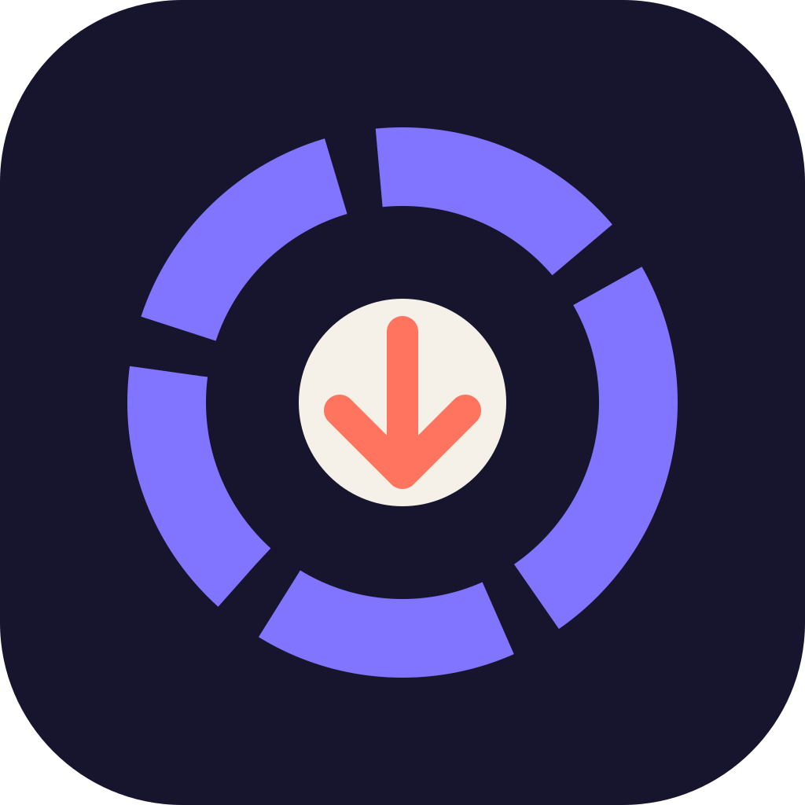
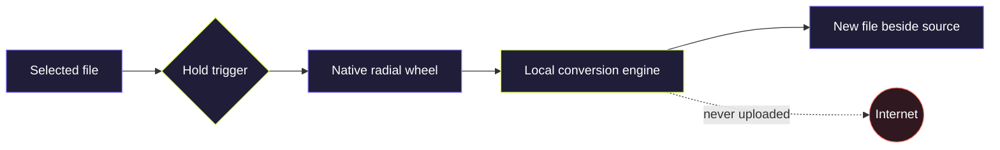

<div align="center">
  

  <br />

  

  # OrbitDrop

  ### The desktop file-action engine that appears exactly where your file already is.

  Select a file. Hold your key. Glide to an action. Release.
  <br />
  **No upload. No browser detour. No account.**

  [](https://orbitdropapp.vercel.app/#download)
  [](https://orbitdropapp.vercel.app)

  [](https://github.com/sasukefrontenddev/orbitdrop/actions/workflows/build.yml)
  [](https://github.com/sasukefrontenddev/orbitdrop/releases/latest)
  [](https://orbitdropapp.vercel.app/requirements)
  [](https://orbitdropapp.vercel.app/requirements)
  [](PRIVACY.md)

  <sub>Native AppKit on macOS · Native WPF on Windows · Source available for inspection</sub>
</div>

---

## One gesture. An entire toolbox.

<div align="center">
  
  <br />
  <sub>A real OrbitDrop gesture — the wheel is summoned over the desktop, not inside a web page.</sub>
</div>

```text
                 ┌──────── deliberate hold ────────┐
                 │                                  ▼
  SELECT FILE  ──┴──  HOLD YOUR KEY  ──  GLIDE TO ACTION  ──  RELEASE
       ▲                                                      │
       └────────────── new output beside source ──────────────┘
```

A quick tap still behaves like the original key. Only a deliberate hold calls OrbitDrop. Letters, numbers, punctuation, arrows, modifiers, Space, and function keys can all be recorded directly—there is no cramped dropdown of “approved” shortcuts.

## The command constellation

| ◌ Convert | ◌ Optimize & organize | ◌ Transform images |
| :--- | :--- | :--- |
| Documents and images → **PDF** | Adaptive **Shrink** | **Resize** to 50% |
| Images → **PNG** | Maximum-compression **ZIP** | **Rotate** 90° |
| Images → **JPG** | Standard **ZIP** archives | **Flip** horizontally |
| Images → **TIFF** | Collision-safe **Copy** | Convert to **grayscale** |
| Images → **BMP** | Files and complete folders | Preserve the source file |

DOCX, RTF, TXT, HTML, common image formats, multiple selections, and folders are handled by the local engine. On Windows, OrbitDrop uses Microsoft Word for the highest-fidelity DOCX-to-PDF result when Word is available.

## Privacy is not a setting. It is the shape of the app.



| What OrbitDrop does | What OrbitDrop never needs |
| --- | --- |
| Processes file contents on your computer | Upload access to your documents |
| Writes a new, collision-safe output | An account or cloud workspace |
| Stores the chosen trigger locally | Advertising IDs or conversion history |
| Reads the public release feed for updates | Analytics, pixels, or behavioral tracking |

Read the complete, plain-language [privacy promise](PRIVACY.md).

## Native all the way down

| | macOS | Windows |
| --- | --- | --- |
| **Interface** | Swift + AppKit | C# + WPF |
| **Support** | macOS 13 Ventura or later | 64-bit Windows 10 and Windows 11 |
| **CPU** | Universal: Apple Silicon + Intel | Self-contained x64 executable |
| **Gesture layer** | Finder-aware Accessibility event tap | File Explorer-aware native keyboard hook |
| **Output** | Beside the source file | Beside the source file |

This is not a website placed inside a desktop window. The website is only the front door; conversions, compression, archives, image edits, and the radial interaction live in the native apps.

## Install in under a minute

<details open>
<summary><strong>macOS</strong></summary>

1. Download and unzip the universal macOS package from the [official download page](https://orbitdropapp.vercel.app/#download).
2. Move `OrbitDrop.app` to **Applications**.
3. This early release is not notarized, so Control-click OrbitDrop, choose **Open**, and confirm.
4. Grant Accessibility access when asked. OrbitDrop uses it only for the configured hold-key gesture.

If the menu says **Keyboard: access required**, choose **Repair Keyboard Access…**, remove any stale OrbitDrop entry, add the copy in Applications, enable it, and reopen OrbitDrop. The menu should then show **Keyboard: ready ✓**.

</details>

<details>
<summary><strong>Windows</strong></summary>

1. Download the Windows x64 executable from the [official download page](https://orbitdropapp.vercel.app/#download).
2. Compare its SHA-256 value with the [checksum directory](https://orbitdropapp.vercel.app/checksums).
3. This early release is not Authenticode-signed. If SmartScreen appears, choose **More info** and **Run anyway** only after the checksum matches.

The executable is self-contained; a separate .NET installation is not required.

</details>

## Updates that replace the app—not multiply it

OrbitDrop checks the public GitHub release feed shortly after launch and every six hours while running. Starting with version 0.6.1, **Install Update**:

```text
discover → stage privately → verify SHA-256 + version → replace app → relaunch → clean up
                                                    ↘ restore previous copy if replacement fails
```

The check sends no file, filename, account, device identifier, or conversion history. Versions older than 0.6.1 need one final manual installation; later releases update in place.

## Build the engines

<details>
<summary><strong>Build and test on macOS</strong></summary>

Requirements: macOS 13+, Xcode Command Line Tools, and Swift.

```bash
zsh macos/test.sh
zsh macos/build.sh
```

The universal application is created at `macos/build/OrbitDrop.app`.

</details>

<details>
<summary><strong>Build on Windows</strong></summary>

Requirements: Windows 10/11 and the .NET 8 SDK.

```powershell
powershell -ExecutionPolicy Bypass -File windows/build.ps1
```

The self-contained x64 executable is created under `windows/build/win-x64`.

</details>

## From commit to trusted download

Every pull request and change to `main` builds both native apps and runs platform checks. An accepted version change triggers a release pipeline that validates matching versions, rebuilds on each native operating system, generates SHA-256 checksums, publishes build-provenance attestations, and uploads the packages to GitHub Releases.

The companion [OrbitDrop website repository](https://github.com/sasukefrontenddev/orbitdrop-website) reads the verified release automatically, keeping its download buttons, version, sizes, and checksum page current without hosting a second copy of the installer.

## Enter the orbit

| You want to… | Go here |
| --- | --- |
| Download the newest build | [Official download](https://orbitdropapp.vercel.app/#download) |
| Verify a download | [Checksums and commands](https://orbitdropapp.vercel.app/verify) |
| Report a bug | [GitHub Issues](https://github.com/sasukefrontenddev/orbitdrop/issues) |
| Propose a focused improvement | [Contributing guide](CONTRIBUTING.md) |
| Report a vulnerability privately | [Security policy](SECURITY.md) |
| See what changed | [Release history](https://orbitdropapp.vercel.app/releases) |

## License

OrbitDrop is source-available for inspection, security review, education, and portfolio evaluation. It is **not open source**: copying, modification, redistribution, sublicensing, sale, and derivative works require prior written permission. See [LICENSE](LICENSE).

---

<div align="center">
  <strong>Your files have places to go. The internet is not one of them.</strong>
  <br />
  <sub>Built for macOS and Windows · No uploads · No tracking · No account</sub>
  <br /><br />
  <a href="https://github.com/sasukefrontenddev/orbitdrop/stargazers">★ Star OrbitDrop</a>
  &nbsp;·&nbsp;
  <a href="https://orbitdropapp.vercel.app">Visit the launch site</a>
</div>
