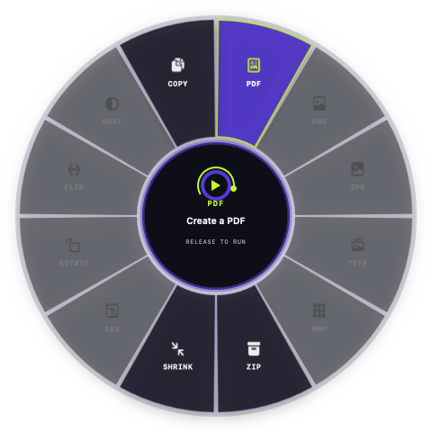

# OrbitDrop

Native, privacy-first desktop file tools for macOS and Windows.

OrbitDrop adds a transparent radial command wheel to Finder and File Explorer. Select a file, right-click, glide to an action, and release. Conversion and editing happen entirely on the computer—no uploads, accounts, analytics, cookies, or telemetry.

[Download OrbitDrop](https://orbitdropapp.vercel.app/#download) · [Product website](https://orbitdropapp.vercel.app) · [Website source](https://github.com/sasukefrontenddev/orbitdrop-website)



## Features

| Convert | Optimize and organize | Edit images |
| --- | --- | --- |
| PDF | ZIP | Resize to 50% |
| PNG | Shrink | Rotate 90° |
| JPG | Safe copy | Flip horizontally |
| TIFF |  | Grayscale |
| BMP |  |  |

- Native AppKit utility for macOS 13+ on Apple Silicon and Intel.
- Native WPF utility for 64-bit Windows 10 and Windows 11.
- Dark, transparent command wheel with native/vector icons.
- Visible local-processing, success, and failure states.
- New output files are created beside the original; source files are not overwritten.
- Works offline after installation.

## Install

Download the latest installers from the [OrbitDrop releases page](https://github.com/sasukefrontenddev/orbitdrop/releases/latest) or the [official website](https://orbitdropapp.vercel.app/#download).

### macOS

1. Download and unzip the universal macOS package.
2. Move `OrbitDrop.app` to Applications.
3. Control-click the app, choose **Open**, and confirm.
4. Grant Accessibility access when macOS requests it so OrbitDrop can detect the Finder gesture.

### Windows

1. Download the Windows x64 executable.
2. Verify its SHA-256 checksum.
3. If SmartScreen appears, choose **More info** and **Run anyway** only when the checksum matches.

The current early release is not Developer ID / Authenticode signed or notarized.

## Build from source

### macOS

Requirements: macOS 13+, Xcode Command Line Tools, and Swift.

```bash
zsh macos/test.sh
zsh macos/build.sh
```

The universal app is created at `macos/build/OrbitDrop.app`.

### Windows

Requirements: Windows 10/11 and the .NET 8 SDK.

```powershell
powershell -ExecutionPolicy Bypass -File windows/build.ps1
```

The self-contained x64 executable is created under `windows/build/win-x64`.

## Privacy

OrbitDrop performs file operations locally. It has no server API, upload system, user database, analytics SDK, advertising identifier, or telemetry endpoint. See [PRIVACY.md](PRIVACY.md) for the complete promise.

## Release automation

Every pull request and change to `main` builds and tests the native macOS and Windows apps. To publish a release:

1. Run `sh scripts/set-version.sh 0.5.0` with the intended version.
2. Commit and merge the version change after the required owner review.
3. The successful `main` build automatically creates and publishes the matching release. **Actions → Desktop release → Run workflow** is available only as a recovery option.

The release workflow creates the version tag, rebuilds both apps on their native operating systems, generates SHA-256 checksums, publishes build-provenance attestations, and uploads the installers to GitHub Releases. The product website reads the latest verified release automatically, so its download buttons, version number, file sizes, and checksum directory update without copying installers into the website repository.

## Repository policy

The source is published for transparency and portfolio review. See [LICENSE](LICENSE) before copying or redistributing it. Contributions and responsible security reports are welcome.
